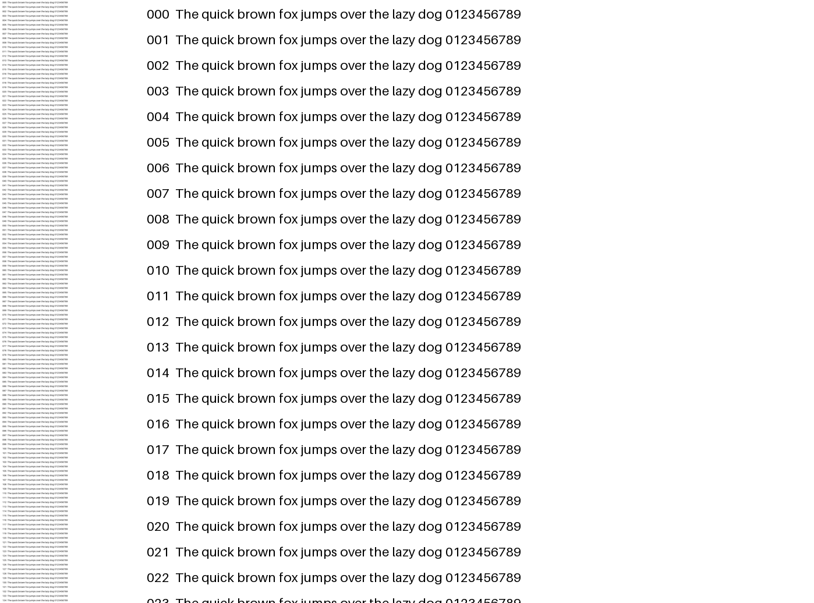
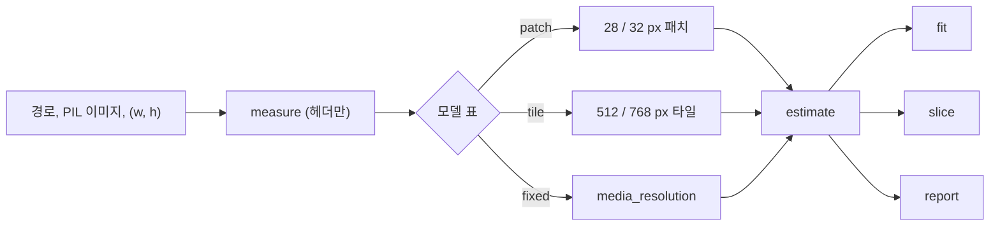
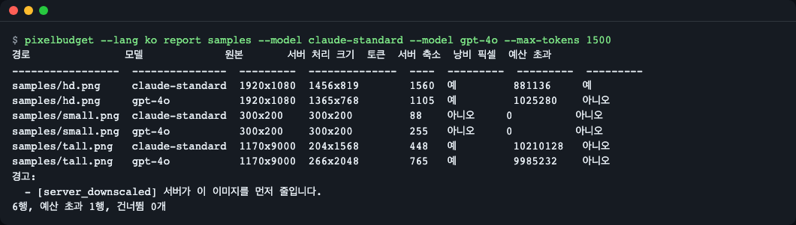
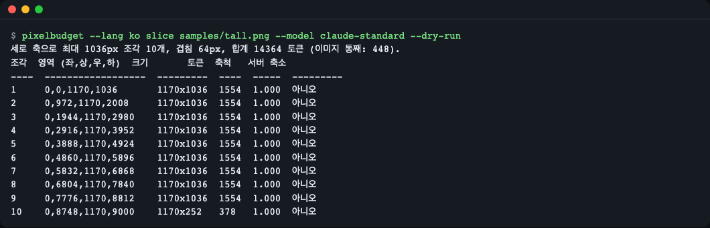
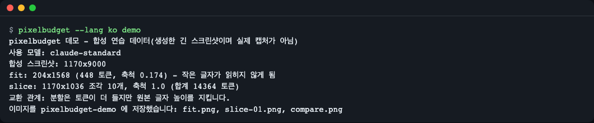

# pixelbudget

[English](README.md) | **한국어**

비전 LLM 에 이미지를 보내기 전에 비용(토큰)을 미리 알고, 토큰 예산에 맞춰 줄이고, 세로로 긴 스크린샷은 글자가 읽히는 조각으로 자르고, 폴더 전체를 점검해 예산을 넘으면 종료 코드로 CI 를 실패시키는 오프라인 파이썬 라이브러리 + CLI 입니다. 의존성은 Pillow 하나이고, 모델 표의 모든 규칙에 출처 URL·확인 날짜·신뢰도(confidence)가 붙어 있습니다.



*왼쪽: 1170x9000 페이지 전체를 Claude 토큰 한도에 맞춰 줄인 모습. 오른쪽: 원래 배율 그대로의 첫 조각(1170x1036). 페이지는 `pixelbudget demo` 가 만든 연습용 합성 이미지입니다.*

## 설치

```bash
uv add git+https://github.com/LeeGyeongPil/pixelbudget
# 또는: pip install git+https://github.com/LeeGyeongPil/pixelbudget
```

Python 3.11 이상, 런타임 의존성은 Pillow 13 하나입니다. 아직 PyPI 에는 올라가 있지 않습니다. clone 해서 써 보려면:

```bash
git clone https://github.com/LeeGyeongPil/pixelbudget && cd pixelbudget
uv sync            # uv 설치: https://docs.astral.sh/uv/ (curl -LsSf https://astral.sh/uv/install.sh | sh)
```

API 키도 네트워크도 필요 없습니다.

## 빠르게 시작하기

```python
from pixelbudget import estimate, fit_size

est = estimate((1920, 1080), "claude-standard")
print(f"claude-standard 1920x1080 -> {est.sent_size[0]}x{est.sent_size[1]} = {est.tokens} tokens")

plan = fit_size((1920, 1080), "claude-standard", budget=800)
print(f"fit_size budget=800 -> {plan.size[0]}x{plan.size[1]} = {plan.tokens} tokens ({plan.reason})")
```

`examples/quickstart.py` 이며 `uv run python examples/quickstart.py` 로 실행합니다:

```text
claude-standard 1920x1080 -> 1456x819 = 1560 tokens
fit_size budget=800 -> 1046x588 = 798 tokens (resized_to_budget)
```

1920x1080 스크린샷은 그대로 처리되지 않습니다. 서버가 먼저 1456x819 로 줄인 뒤 토큰을 셉니다. 직접 줄여서 보내면 토큰은 같고 업로드할 픽셀만 줄어듭니다.

## 핵심 개념

1. **과금 기준은 파일 크기가 아니라 픽셀 격자입니다.** 제공자마다 이미지를 패치(Claude 28px, 새 OpenAI 모델 32px), 512px 타일(구형 OpenAI 모델·Gemini 2), 또는 이미지당 고정 토큰(Gemini 3)으로 셉니다.
2. **서버가 먼저 이미지를 줄일 수 있습니다.** 긴 변이나 토큰 수 상한을 넘으면 조용히 리사이즈합니다. `estimate` 는 `sent_size` 와 `server_downscaled` 를 돌려주고, `report` 는 헛되이 올린 `Wasted px` 를 보여 줍니다.
3. **fit 은 "예산 이하이면서 서버가 다시 줄이지 않는 크기"입니다.** 토큰 수는 계단식(`ceil`)이라 긴 변을 이분 탐색하며, 확대는 하지 않습니다.
4. **조각 길이는 변 한도가 아니라 토큰 한도로 정합니다.** 폭 1170px 은 패치 42개 폭이고, 1568 토큰 / 42 = 37행 = 조각당 1036px 입니다. 1568px 조각은 서버가 또 줄입니다.



입력을 측정하고, 모델 규칙을 적용한 뒤, 추정·맞춤·분할 계획·보고서로 씁니다. 자세한 설명은 [docs/how-it-works.md](docs/how-it-works.md) (영어) 에 있습니다.

## API

모든 이름은 `pixelbudget` 에서 가져옵니다. 입력(`ImageSource`)은 경로, `PIL.Image.Image`, `(width, height)` 튜플입니다.

| 이름 | 하는 일 | 주요 인자 | 반환 |
|---|---|---|---|
| `estimate` | 토큰 수와 서버가 실제로 처리할 크기 | `source`, `model`, `detail=None` | `Estimate` |
| `fit_size` | 예산·제공자 한도 안에서 가장 큰 크기 (픽셀은 건드리지 않음) | `size`, `model`, `budget=None`, `detail=None` | `FitPlan` |
| `fit` | `fit_size` + 리사이즈된 이미지(기본 LANCZOS) | `image`, `model`, `budget`, `detail`, `resample`, `max_pixels` | `FitResult(image, plan)` |
| `plan_slices` | 조각 좌표, 조각별·전체 토큰 | `size`, `model`, `overlap=64`, `detail=None` | `SlicePlan` |
| `slice_image` | `plan_slices` + 잘라 낸 이미지 | `image`, `model`, `overlap`, `detail`, `max_pixels` | `SliceResult(images, plan)` |
| `report` / `build_report` | 이미지·모델마다 한 행. `build_report` 는 건너뛴 파일도 알려 줌 | `paths`, `models`, `detail`, `max_tokens`, `prices` | `list[ReportRow]` / `ReportResult` |
| `measure` | 헤더에서 이미지 크기 읽기 (EXIF 방향 반영) | `source` | `(w, h)` |
| `list_models` / `get_model` | 모델 표 읽기 | `name` | `list[ModelSpec]` / `ModelSpec` |

예외는 모두 `PixelBudgetError` 를 상속하고 안정적인 `.code` 를 가집니다: `UnknownModelError`, `UnsupportedDetailError`, `InvalidBudgetError`, `InvalidOverlapError`, `InvalidSizeError`, `UnreadableImageError`, `ImageTooLargeError`, `ModelTableError`.

경고는 `.warnings` 의 고정 코드입니다: `server_downscaled`, `fixed_per_image`, `slice_increases_tokens`, `many_images`, `approx_rounding`, `approx_rule`, `docs_table_mismatch`, `decompression_guard`.

지원 모델은 `pixelbudget models` 로 봅니다(16행, 각 행에 출처 URL·확인 날짜·신뢰도).

## 사용 예

아래 예제는 합성 이미지 3장을 씁니다. 먼저 만드세요(1920x1080 프레임, 300x200 아이콘, 1170x9000 세로 페이지를 Pillow 로 그립니다):

```bash
uv run python examples/make_samples.py samples
```

```text
wrote 3 images to samples/
```

### 1. 폴더를 점검하고 예산 초과면 CI 를 실패시키기

```bash
uv run pixelbudget --lang ko report samples --model claude-standard --model gpt-4o --max-tokens 1500
```



*이미지·모델마다 한 행이 나옵니다. 한 행이라도 `--max-tokens` 를 넘으면 종료 코드가 1 이라(여기서는 Claude 의 `hd.png`: 1560 > 1500) CI 점검으로 쓸 수 있습니다.*

아래는 `--lang en` 으로 실행한 실제 출력입니다(`--lang ko` 출력은 위 스크린샷):

```text
Path               Model            Original   Server size  Tokens  Downscaled  Wasted px  Over budget
-----------------  ---------------  ---------  -----------  ------  ----------  ---------  -----------
samples/hd.png     claude-standard  1920x1080  1456x819     1560    yes         881136     yes
samples/hd.png     gpt-4o           1920x1080  1365x768     1105    yes         1025280    no
samples/small.png  claude-standard  300x200    300x200      88      no          0          no
samples/small.png  gpt-4o           300x200    300x200      255     no          0          no
samples/tall.png   claude-standard  1170x9000  204x1568     448     yes         10210128   no
samples/tall.png   gpt-4o           1170x9000  266x2048     765     yes         9985232    no
Warnings:
  - [server_downscaled] The server will downscale this image first.
6 rows, 1 over budget, 0 skipped
```

`pixelbudget estimate` 는 예산 열 없이 같은 표를 보여 줍니다(`--price`·`--max-tokens` 옵션이 없어 `--price` 를 주면 종료 코드 2 로 거부됩니다). 비용은 `report` 에 `--price 모델=USD`(백만 토큰당 가격, 직접 넣는 값이며 가격 데이터는 포함하지 않습니다)를 줄 때만 나옵니다. `--format json` 은 기계가 읽는 출력입니다.

### 2. 토큰 예산에 맞춰 줄이기

```bash
uv run pixelbudget --lang ko fit samples/hd.png --model claude-standard --budget 800 --out out/hd-fit.png
```

```text
out/hd-fit.png 저장: 1046x588, 798 토큰 (축척 0.545).
```

파이썬에서는 `fitted = fit("samples/hd.png", "claude-standard", budget=800)` 입니다. `fitted.image` 는 Pillow 이미지, `fitted.plan` 은 상세 정보입니다.

Gemini 3 은 이미지당 고정 과금이라 리사이즈가 도움이 안 되고, 도구는 파일을 쓰는 대신 그렇게 알려 줍니다:

```bash
uv run pixelbudget --lang ko fit samples/hd.png --model gemini-3 --budget 500
```

```text
gemini-3 은 리사이즈해도 비용이 같습니다: 이미지당 토큰 고정(1120). 파일을 쓰지 않았습니다.
예산 500 에 맞추려면 media_resolution low (280) 로 설정하세요.
```

### 3. 긴 스크린샷을 글자가 읽히게 자르기

```bash
uv run pixelbudget --lang ko slice samples/tall.png --model claude-standard --dry-run
```



*원래 배율(1.0)의 1170x1036 조각 10개. 통째로 보내면 448 토큰이지만 204x1568 로 줄어 글자를 읽을 수 없고, 조각은 합계 14364 토큰입니다. 분할은 토큰을 써서 가독성을 사는 선택입니다.*

```text
세로 축으로 최대 1036px 조각 10개, 겹침 64px, 합계 14364 토큰 (이미지 통째: 448).
조각  영역 (좌,상,우,하)  크기       토큰  축척   서버 축소
----  ------------------  ---------  ----  -----  ---------
1     0,0,1170,1036       1170x1036  1554  1.000  아니오
2     0,972,1170,2008     1170x1036  1554  1.000  아니오
3     0,1944,1170,2980    1170x1036  1554  1.000  아니오
4     0,2916,1170,3952    1170x1036  1554  1.000  아니오
5     0,3888,1170,4924    1170x1036  1554  1.000  아니오
6     0,4860,1170,5896    1170x1036  1554  1.000  아니오
7     0,5832,1170,6868    1170x1036  1554  1.000  아니오
8     0,6804,1170,7840    1170x1036  1554  1.000  아니오
9     0,7776,1170,8812    1170x1036  1554  1.000  아니오
10    0,8748,1170,9000    1170x252   378   1.000  아니오
```

(위는 `--lang ko` 로 실행한 실제 출력입니다.) `--dry-run` 을 빼고 `--out-dir out/pieces` 를 주면 파일 10개를 씁니다. 파이썬에서는 `examples/fit_and_slice.py`:

```python
from pixelbudget import fit, plan_slices, slice_image

fitted = fit("samples/tall.png", "claude-standard", budget=800)
print("fit:", fitted.plan.size, fitted.plan.tokens, "tokens", fitted.plan.reason)

plan = plan_slices((1170, 9000), "claude-standard")
print("pieces:", len(plan.pieces), "of", plan.pieces[0].size, "=", plan.total_tokens, "tokens")

result = slice_image("samples/tall.png", "claude-standard")
print("images ready to send:", len(result.images), result.images[0].size)
```

```text
fit: (204, 1568) 448 tokens resized_to_limits
pieces: 10 of (1170, 1036) = 14364 tokens
images ready to send: 10 (1170, 1036)
```

이미지당 고정 과금 모델에서는 분할이 비용만 늘리므로 `plan_slices` 가 `slice_increases_tokens` 경고를 냅니다.

### 4. 내 이미지 없이 해 보기

```bash
uv run pixelbudget --lang ko demo
```



*demo 는 합성 세로 페이지를 그려 fit 과 slice 를 하고 `fit.png`, `slice-01.png`, `compare.png`(이 README 맨 위 그림)를 `pixelbudget-demo/` 에 씁니다.*

```text
pixelbudget 데모 - 합성 연습 데이터(생성한 긴 스크린샷이며 실제 캡처가 아님)
사용 모델: claude-standard
합성 스크린샷: 1170x9000
fit: 204x1568 (448 토큰, 축척 0.174) - 작은 글자가 읽히지 않게 됨
slice: 1170x1036 조각 10개, 축척 1.0 (합계 14364 토큰)
교환 관계: 분할은 토큰이 더 들지만 원본 글자 높이를 지킵니다.
이미지를 pixelbudget-demo 에 저장했습니다: fit.png, slice-01.png, compare.png
```

## 설정

| 설정 | 방법 | 효과 |
|---|---|---|
| 출력 언어 | `--lang en\|ko`, `PIXELBUDGET_LANG`, 그다음 `LC_ALL`/`LC_MESSAGES`/`LANG`; 없으면 영어 | CLI 문구를 영어·한국어로. `--lang` 이 없으면 로케일을 따르므로 한국어 로케일에서는 한국어로 나옵니다. |
| 세부 설정 | `--detail` / `detail=` | 제공자의 detail 설정(타일 모델은 `low`/`high`, Gemini 3 은 `media_resolution`). 기본값은 모델 표에서 옵니다. |
| 예산 종료 코드 | `report --max-tokens N` | 한 행이라도 N 토큰을 넘으면 종료 코드 1, 사용법 오류는 2. |
| 읽을 수 없는 파일 | `report`/`estimate --strict` | 이미지로 읽을 수 없는 파일이 있으면 종료 코드 1. 없으면 건너뛴 파일만 나열하고 종료 코드는 0 입니다. |
| 디코딩 한도 | `--max-pixels` / `max_pixels=` | `fit`·`slice` 는 픽셀을 읽어야 하므로 이 값을 넘는 이미지는 `ImageTooLargeError` (기본값: Pillow 의 `MAX_IMAGE_PIXELS`). |

## 한계 (숫자를 믿기 전에 읽으세요)

- **추정치이지 청구서가 아닙니다.** 값은 제공자의 공개 문서(2026-11-11 확인)에서 옵니다. 실제 청구 사용량과 다를 수 있습니다. 각 행에 `documented`, `measured`, `approx` 가 적혀 있습니다.
- **패치 예산을 넘는 OpenAI 패치 모델은 `approx` 입니다.** 문서가 "비율대로 줄이고 내림한 뒤 다시 계산"이라고만 하고 정확한 반올림을 밝히지 않아 `approx_rounding` 이 붙습니다.
- **Gemini 2 는 `approx` 입니다.** AI Studio 와 Vertex 문서가 규칙을 다르게 설명하고, 포럼에는 카운트와 청구 사용량이 어긋난다는 보고가 있습니다. 대략의 값으로 보세요(`approx_rule`).
- **Gemini 3 이후: 리사이즈가 토큰을 줄이지 않습니다.** 비용은 `media_resolution`(이미지당 low 280, medium 560, high 1120, ultra_high 2240)으로만 정해집니다. `fit` 은 이미지를 그대로 두고 단계를 제안하며, 분할은 비용을 늘립니다.
- **문서끼리 어긋나는 곳이 한 군데 있습니다.** Claude standard 2000x1500: 문서 표는 1269x952, 같은 사이트의 참조 코드는 1270x952 입니다(둘 다 1564 토큰). pixelbudget 은 코드를 따르고 `docs_table_mismatch` 로 경고합니다. 자세한 내용은 [docs/model-table.md](docs/model-table.md) (영어).
- **겉모양 문제.** 한국어 스크린샷 `01-report.ko.png`·`02-slice.ko.png` 은 캡처 글꼴이 한글을 두 칸보다 좁게 그려 일부 열이 어긋나 보이지만, 텍스트 출력 자체는 정렬되어 있습니다.
- **한도가 문서로 확인된 모델만 표에 있습니다.** 확인하지 못한 모델은 뺐습니다(예: `gpt-5.4` 는 `high` 만). 제공자가 규칙을 바꿀 수 있으며, 행은 `src/pixelbudget/data/models.json` 의 평범한 JSON 입니다. 오래된 행을 고치려면 [docs/model-table.md](docs/model-table.md#updating-a-row) (영어)를 따르세요. 방식별 토큰 계산 표도 같은 문서에 있습니다.
- **아직 없는 것:** JSONL 요청 로그 스캔, 실제 사용량 기록과의 보정(calibrate). 가격 데이터도 넣지 않았습니다.
- 분할은 한 장으로 맞춘 것보다 토큰이 더 듭니다. OCR 을 하거나 글자가 정말 읽히는지 검사하지는 않고, 원래 배율만 유지합니다.

출처: [Anthropic vision](https://platform.claude.com/docs/en/build-with-claude/vision), [OpenAI images and vision](https://developers.openai.com/api/docs/guides/images-vision), [Gemini tokens](https://aistudio.google.com/docs/tokens), [Gemini media resolution](https://aistudio.google.com/docs/media-resolution) (모두 2026-11-11 확인).

## 언제 쓰나

- 이럴 때: 비전 모델에 스크린샷·문서 페이지를 많이 보내면서, 요청 전에 비용과 서버 측 축소 여부를 오프라인(코드나 CI)에서 알고 싶을 때.
- 이럴 땐 다른 도구: 여러 종류의 호출 토큰을 한 번에 세는 요청 게이트웨이가 필요하면 [LiteLLM `token_counter`](https://docs.litellm.ai/docs/count_tokens), 청구와 정확히 맞는 숫자가 필요하면 제공자 API 가 돌려주는 사용량(usage) 필드.

## 문제 해결

| 증상 | 원인 | 해결 |
|---|---|---|
| `오류: 알 수 없는 모델입니다: 'foo'. 지원 모델 목록은 `pixelbudget models` 로 확인하세요.` (종료 코드 2) | 표에 없는 모델 이름 | `pixelbudget models` 로 확인. `gemini-4` 같은 별칭은 `gemini-3` 으로 연결됩니다. |
| `오류: 파일이나 폴더가 없습니다: 'nope.png'` (종료 코드 2) | 경로 오류 | 경로를 확인하세요. 폴더는 안의 이미지를 찾아 씁니다. |
| `오류: ... 알 수 없는 이미지 확장자 '.weird'. .png, .jpg, .webp 를 쓰세요.` (종료 코드 2) | `--out` 확장자가 png·jpg·webp 가 아님 | `--out out.png` 처럼 지원 확장자를 쓰세요. |
| `오류: 같은 이름의 파일이 이미 있어 폴더를 만들 수 없습니다: ...` (종료 코드 2) | 출력 폴더 자리에 같은 이름의 파일이 있음 | 파일을 옮기거나 다른 `--out` 폴더를 쓰세요. |
| 영어를 기대했는데 한국어로 나옴 | `--lang` 이 없고 로케일이 한국어 | `--lang en` 을 붙이거나 `PIXELBUDGET_LANG=en`. |
| `fit` 이 아무것도 쓰지 않음 | 이미지당 고정 과금 모델(Gemini 3) | 출력된 `media_resolution` 안내를 따르세요. |
| `ImageTooLargeError` | `fit`/`slice` 가 아주 큰 이미지를 디코딩해야 함 | 파일을 믿을 수 있다면 `--max-pixels` / `max_pixels=` 를 올리세요. |
| `report` 가 `읽을 수 있는 이미지가 없습니다.`(영어 모드에서는 `No readable images found.`)를 내고 종료 코드 0 | 지정한 파일이 올바른 이미지가 아님 | `--strict` 를 붙이면 읽을 수 없는 파일이 있을 때 종료 코드 1 로 실패합니다. 파일을 고치거나 빼세요. |
| `report` 에 행이 더 많이 나옴 | 폴더를 하위까지 훑어 이전 출력도 포함 | 결과를 `out/` 같은 다른 폴더에 쓰세요. |

## 버전·호환성

유의적 버전(SemVer)을 따릅니다. 0.x 동안은 마이너 버전에서 API 가 바뀔 수 있고, 바뀌면 [CHANGELOG.md](CHANGELOG.md) 에 적습니다.

## 개발·기여

```bash
uv sync
uv run pytest -q          # 242 passed, 완전 오프라인(소켓 차단, API 키 환경변수 제거)
uv run python examples/quickstart.py
```

CI 는 Python 3.11 과 3.12 에서 테스트를 돌립니다.

## 라이선스

MIT.
