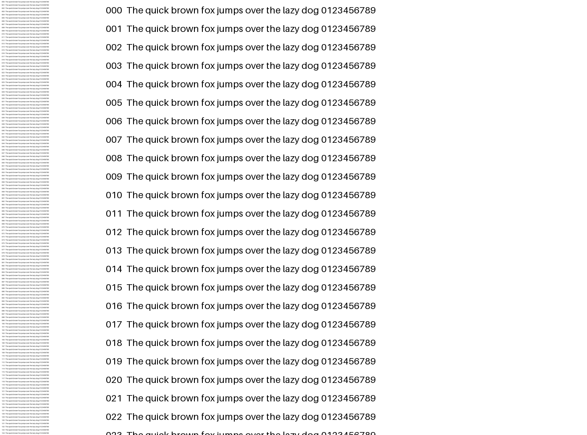
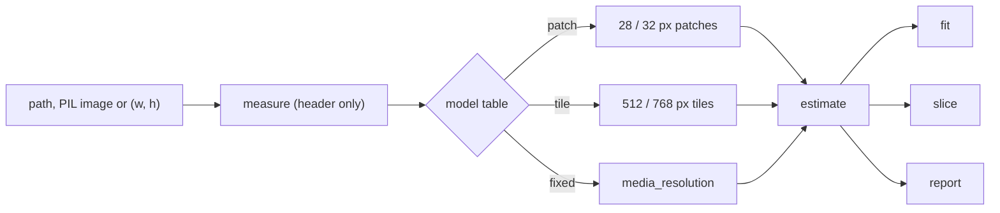
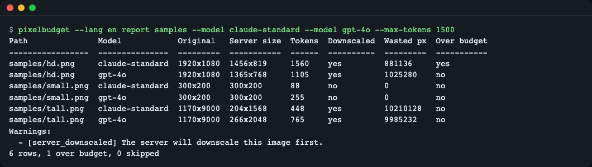
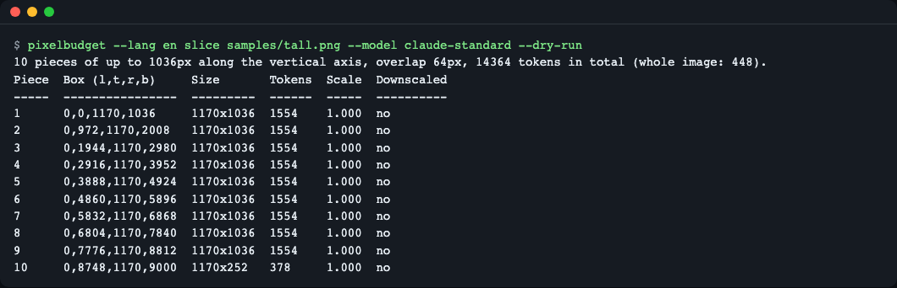
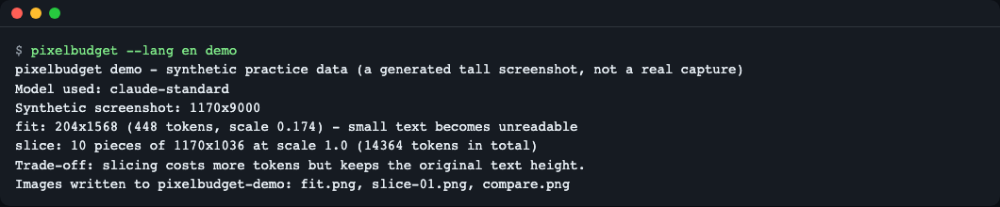

# pixelbudget

**English** | [한국어](README.ko.md)

Know what an image costs a vision LLM before you send it, shrink it to a token budget, cut a long screenshot into pieces whose text stays readable, or audit a whole folder and fail CI with an exit code when an image is over budget. It is a small offline Python library plus a CLI that depends only on Pillow, and every rule in its model table carries a source URL, a check date and a confidence level.



*Left: the whole 1170x9000 page shrunk to fit Claude's token cap. Right: the first 1170x1036 slice at original scale. The page is synthetic (generated by `pixelbudget demo`).*

## Install

```bash
uv add git+https://github.com/LeeGyeongPil/pixelbudget
# or: pip install git+https://github.com/LeeGyeongPil/pixelbudget
```

Python 3.11+ and one runtime dependency (Pillow 13). Not published on PyPI yet. To try it from a clone:

```bash
git clone https://github.com/LeeGyeongPil/pixelbudget && cd pixelbudget
uv sync            # uv: https://docs.astral.sh/uv/ (curl -LsSf https://astral.sh/uv/install.sh | sh)
```

No API key and no network access are needed.

## Quick start

```python
from pixelbudget import estimate, fit_size

est = estimate((1920, 1080), "claude-standard")
print(f"claude-standard 1920x1080 -> {est.sent_size[0]}x{est.sent_size[1]} = {est.tokens} tokens")

plan = fit_size((1920, 1080), "claude-standard", budget=800)
print(f"fit_size budget=800 -> {plan.size[0]}x{plan.size[1]} = {plan.tokens} tokens ({plan.reason})")
```

This is `examples/quickstart.py`; run it with `uv run python examples/quickstart.py`:

```text
claude-standard 1920x1080 -> 1456x819 = 1560 tokens
fit_size budget=800 -> 1046x588 = 798 tokens (resized_to_budget)
```

A 1920x1080 screenshot is not sent as is: the server shrinks it to 1456x819 before counting. Sending the smaller image yourself costs the same tokens and uploads fewer pixels.

## Core concepts

1. **The pixel grid is what is billed, not the file size.** Each provider turns the image into patches (28 px for Claude, 32 px for newer OpenAI models), 512 px tiles (older OpenAI models, Gemini 2), or a fixed number per image (Gemini 3).
2. **The server may shrink the image first.** Past a maximum edge or token count it resizes silently. `estimate` returns `sent_size` and `server_downscaled`, and `report` shows the `Wasted px` you uploaded for nothing.
3. **Fit means "within the budget and not downscaled again".** Token counts are a staircase (`ceil`), so `fit` binary-searches the long edge and never upscales.
4. **Slice by the token cap, not the edge limit.** A 1170 px wide page is 42 patches wide; 1568 tokens / 42 = 37 rows = 1036 px per piece. 1568 px pieces would be shrunk again.



Each input is measured, run through the rule of its model, and then used for an estimate, a fit, a slice plan or a report. More detail is in [docs/how-it-works.md](docs/how-it-works.md).

## API

All names are importable from `pixelbudget`. Sources (`ImageSource`) are a path, a `PIL.Image.Image` or a `(width, height)` tuple.

| Name | What it does | Main arguments | Returns |
|---|---|---|---|
| `estimate` | Tokens and the size the server will process | `source`, `model`, `detail=None` | `Estimate` |
| `fit_size` | Largest size within a budget and the provider limits, no pixels touched | `size`, `model`, `budget=None`, `detail=None` | `FitPlan` |
| `fit` | `fit_size` plus the resized image (LANCZOS by default) | `image`, `model`, `budget`, `detail`, `resample`, `max_pixels` | `FitResult(image, plan)` |
| `plan_slices` | Piece boxes, tokens per piece and total | `size`, `model`, `overlap=64`, `detail=None` | `SlicePlan` |
| `slice_image` | `plan_slices` plus the cropped images | `image`, `model`, `overlap`, `detail`, `max_pixels` | `SliceResult(images, plan)` |
| `report` / `build_report` | One row per image and model; `build_report` also lists skipped files | `paths`, `models`, `detail`, `max_tokens`, `prices` | `list[ReportRow]` / `ReportResult` |
| `measure` | Image size from the header (applies EXIF orientation) | `source` | `(w, h)` |
| `list_models` / `get_model` | Read the model table | `name` | `list[ModelSpec]` / `ModelSpec` |

Errors all derive from `PixelBudgetError` and carry a stable `.code`: `UnknownModelError`, `UnsupportedDetailError`, `InvalidBudgetError`, `InvalidOverlapError`, `InvalidSizeError`, `UnreadableImageError`, `ImageTooLargeError`, `ModelTableError`.

Warnings are stable codes in `.warnings`: `server_downscaled`, `fixed_per_image`, `slice_increases_tokens`, `many_images`, `approx_rounding`, `approx_rule`, `docs_table_mismatch`, `decompression_guard`.

Run `pixelbudget models` for the supported models (16 rows, each with source URL, check date and confidence).

## Usage

The examples below use three synthetic images. Create them first (a 1920x1080 frame, a 300x200 icon and a 1170x9000 tall page, drawn with Pillow):

```bash
uv run python examples/make_samples.py samples
```

```text
wrote 3 images to samples/
```

### 1. Audit a folder, fail CI when it is over budget

```bash
uv run pixelbudget --lang en report samples --model claude-standard --model gpt-4o --max-tokens 1500
```



*Each image and model gets a row. The exit code is 1 when any row is over `--max-tokens` (here `hd.png` on Claude: 1560 > 1500), so the command works as a CI check.*

```text
Path               Model            Original   Server size  Tokens  Downscaled  Wasted px  Over budget
-----------------  ---------------  ---------  -----------  ------  ----------  ---------  -----------
samples/hd.png     claude-standard  1920x1080  1456x819     1560    yes         881136     yes
samples/hd.png     gpt-4o           1920x1080  1365x768     1105    yes         1025280    no
samples/small.png  claude-standard  300x200    300x200      88      no          0          no
samples/small.png  gpt-4o           300x200    300x200      255     no          0          no
samples/tall.png   claude-standard  1170x9000  204x1568     448     yes         10210128   no
samples/tall.png   gpt-4o           1170x9000  266x2048     765     yes         9985232    no
Warnings:
  - [server_downscaled] The server will downscale this image first.
6 rows, 1 over budget, 0 skipped
```

`pixelbudget estimate` prints the same table without the budget column (it has no `--price` or `--max-tokens`; passing `--price` is rejected with exit 2). Only `report` shows costs, and only when you pass `--price MODEL=USD` (price per million tokens is your input; no prices are bundled). `--format json` gives machine-readable output.

### 2. Fit an image to a token budget

```bash
uv run pixelbudget --lang en fit samples/hd.png --model claude-standard --budget 800 --out out/hd-fit.png
```

```text
Wrote out/hd-fit.png: 1046x588, 798 tokens (scale 0.545).
```

In Python: `fitted = fit("samples/hd.png", "claude-standard", budget=800)`; `fitted.image` is a Pillow image, `fitted.plan` the details.

Gemini 3 charges per image, so resizing cannot help, and the tool says so instead of writing a file:

```bash
uv run pixelbudget --lang en fit samples/hd.png --model gemini-3 --budget 500
```

```text
Resizing does not change the cost of gemini-3: tokens are fixed per image (1120). Nothing written.
To fit the budget of 500, set media_resolution low (280).
```

### 3. Slice a long screenshot so text stays readable

```bash
uv run pixelbudget --lang en slice samples/tall.png --model claude-standard --dry-run
```



*Ten pieces of 1170x1036 at scale 1.0. The whole image would cost 448 tokens but at 204x1568 the text is unreadable; the slices cost 14364 tokens in total. Slicing trades tokens for legibility.*

```text
10 pieces of up to 1036px along the vertical axis, overlap 64px, 14364 tokens in total (whole image: 448).
Piece  Box (l,t,r,b)     Size       Tokens  Scale  Downscaled
-----  ----------------  ---------  ------  -----  ----------
1      0,0,1170,1036     1170x1036  1554    1.000  no
2      0,972,1170,2008   1170x1036  1554    1.000  no
3      0,1944,1170,2980  1170x1036  1554    1.000  no
4      0,2916,1170,3952  1170x1036  1554    1.000  no
5      0,3888,1170,4924  1170x1036  1554    1.000  no
6      0,4860,1170,5896  1170x1036  1554    1.000  no
7      0,5832,1170,6868  1170x1036  1554    1.000  no
8      0,6804,1170,7840  1170x1036  1554    1.000  no
9      0,7776,1170,8812  1170x1036  1554    1.000  no
10     0,8748,1170,9000  1170x252   378     1.000  no
```

Drop `--dry-run` and add `--out-dir out/pieces` to write the ten files. In Python, `examples/fit_and_slice.py`:

```python
from pixelbudget import fit, plan_slices, slice_image

fitted = fit("samples/tall.png", "claude-standard", budget=800)
print("fit:", fitted.plan.size, fitted.plan.tokens, "tokens", fitted.plan.reason)

plan = plan_slices((1170, 9000), "claude-standard")
print("pieces:", len(plan.pieces), "of", plan.pieces[0].size, "=", plan.total_tokens, "tokens")

result = slice_image("samples/tall.png", "claude-standard")
print("images ready to send:", len(result.images), result.images[0].size)
```

```text
fit: (204, 1568) 448 tokens resized_to_limits
pieces: 10 of (1170, 1036) = 14364 tokens
images ready to send: 10 (1170, 1036)
```

On a fixed-per-image model slicing only multiplies the cost, and `plan_slices` warns with `slice_increases_tokens`.

### 4. Try it without your own images

```bash
uv run pixelbudget --lang en demo
```



*The demo draws a synthetic tall page, fits it, slices it and writes `fit.png`, `slice-01.png` and `compare.png` (the picture at the top of this README) to `pixelbudget-demo/`.*

```text
pixelbudget demo - synthetic practice data (a generated tall screenshot, not a real capture)
Model used: claude-standard
Synthetic screenshot: 1170x9000
fit: 204x1568 (448 tokens, scale 0.174) - small text becomes unreadable
slice: 10 pieces of 1170x1036 at scale 1.0 (14364 tokens in total)
Trade-off: slicing costs more tokens but keeps the original text height.
Images written to pixelbudget-demo: fit.png, slice-01.png, compare.png
```

## Configuration

| Setting | How | Effect |
|---|---|---|
| Output language | `--lang en\|ko`, `PIXELBUDGET_LANG`, then `LC_ALL`/`LC_MESSAGES`/`LANG`; English if none | CLI text in English or Korean. Without `--lang` it follows your locale, so a Korean locale prints Korean. |
| Detail level | `--detail` / `detail=` | The provider's detail setting (for example `low`/`high` on tile models, `media_resolution` on Gemini 3). Defaults come from the model table. |
| Budget exit code | `report --max-tokens N` | Exit 1 when any row is above N tokens; usage errors exit 2. |
| Unreadable files | `report`/`estimate --strict` | Exit 1 when a file could not be read as an image. Without it, skipped files are listed and the exit code stays 0. |
| Decode guard | `--max-pixels` / `max_pixels=` | `fit` and `slice` need pixels; images above this count raise `ImageTooLargeError` (default: Pillow's `MAX_IMAGE_PIXELS`). |

## Limits (read this before trusting a number)

- **Estimates, not invoices.** Counts come from the providers' public documentation, checked on 2026-11-11. They can differ from billed usage. Each row says `documented`, `measured` or `approx`.
- **OpenAI patch models over the patch budget are `approx`.** The docs say "scale down, round down, recompute" without the exact rounding, so those results carry `approx_rounding`.
- **Gemini 2 is `approx`.** The AI Studio and Vertex pages describe the rule differently, and forum reports show counts and billed usage disagreeing. Treat it as a rough number (`approx_rule`).
- **Gemini 3 and later: resizing does not reduce tokens.** Cost depends only on `media_resolution` (low 280, medium 560, high 1120, ultra_high 2240 per image). `fit` leaves the image alone and suggests a level; slicing multiplies the cost.
- **Docs disagree with themselves in one place.** Claude standard at 2000x1500: the docs table says 1269x952, the reference code on the same site gives 1270x952 (both 1564 tokens). pixelbudget follows the code and warns with `docs_table_mismatch`. Details in [docs/model-table.md](docs/model-table.md).
- **Cosmetic quirks.** In English output a single-row summary reads `1 rows` (no singular form yet). In the Korean screenshots `01-report.ko.png` and `02-slice.ko.png` some columns look shifted because the capture font draws Hangul narrower than two cells; the text output itself is aligned.
- **Only models with documented limits are in the table.** Models whose limits could not be confirmed are left out (for example `gpt-5.4` has `high` only). Providers change these rules; rows are plain JSON in `src/pixelbudget/data/models.json`. To update a stale row, follow [docs/model-table.md](docs/model-table.md#updating-a-row); the same page lists how each method counts tokens.
- **Not implemented yet:** scanning JSONL request logs and calibrating against real usage records. No pricing data is bundled.
- Slicing costs more tokens than a fitted single image. It does not OCR or check that text is actually readable; it only keeps the original scale.

Sources: [Anthropic vision](https://platform.claude.com/docs/en/build-with-claude/vision), [OpenAI images and vision](https://developers.openai.com/api/docs/guides/images-vision), [Gemini tokens](https://aistudio.google.com/docs/tokens), [Gemini media resolution](https://aistudio.google.com/docs/media-resolution) (all checked 2026-11-11).

## When to use it

- Good fit: you send many screenshots or document pages to a vision model and want to know the cost and any server-side shrinking before the request, offline, in code or CI.
- Another tool may suit you better: you want a request gateway that counts tokens for many kinds of calls, see [LiteLLM `token_counter`](https://docs.litellm.ai/docs/count_tokens); you want a billing-accurate number, use the usage fields returned by the provider's own API.

## Troubleshooting

| Symptom | Cause | Fix |
|---|---|---|
| `error: Unknown model 'foo'. Run `pixelbudget models` to list supported models.` (exit 2) | Model name not in the table | Run `pixelbudget models`; aliases such as `gemini-4` map to `gemini-3`. |
| `error: [Errno 2] No such file or directory: 'nope.png'` (exit 2) | Wrong path | Check the path; folders are scanned for images. |
| `error: Cannot save '...y.weird': unknown image file extension '.weird'. Use .png, .jpg or .webp.` (exit 2) | `--out` extension is not png, jpg or webp | Use a supported extension such as `--out out.png`. |
| `error: [Errno 17] File exists: '...'` (exit 2) | A file occupies the place of the output folder | Move the file or choose another `--out` folder. |
| CLI prints Korean although you expected English | `--lang` not set and your locale is Korean | Add `--lang en` or set `PIXELBUDGET_LANG=en`. |
| `fit` writes nothing | The model charges per image (Gemini 3) | Follow the printed `media_resolution` hint. |
| `ImageTooLargeError` | `fit`/`slice` need to decode a huge image | Raise `--max-pixels` / `max_pixels=` if you trust the file. |
| `report` prints `No readable images found.` and exits 0 | The named file is not a valid image | Add `--strict` so unreadable files fail the run (exit 1); fix or remove the file. |
| `report` counts extra rows | Folders are scanned recursively, including earlier output | Write results to a different folder such as `out/`. |

## Versions and compatibility

Semantic Versioning. While the version is 0.x the API may change in a minor release; changes are listed in [CHANGELOG.md](CHANGELOG.md).

## Development

```bash
uv sync
uv run pytest -q          # 238 passed, fully offline (sockets are blocked, API key variables removed)
uv run python examples/quickstart.py
```

CI runs the tests on Python 3.11 and 3.12.

## License

MIT.
