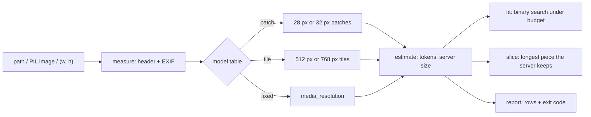

# How it works

Vision APIs price an image by its **pixel grid**, not its file size, and each provider uses its own rule.

## Server-side downscale

Past a maximum edge or token count the server silently shrinks the image (keeping the aspect ratio).
For Claude the **token cap** usually decides: 1920x1080 does not become 1568x882 but 1456x819 (1560 tokens).
Sending the smaller image yourself costs the same tokens and saves upload time. `estimate` returns that
`sent_size` and `server_downscaled`; `report` adds `wasted_pixels`.

## fit

Token counts are a staircase (`ceil`), so `fit` binary-searches the long edge for the largest size that
is within the budget **and** not downscaled by the server, then checks the next few pixels.
It never upscales. For fixed-per-image models it changes nothing and says why.

## slice

A 1170x9000 screenshot fitted to the Claude standard tier becomes 204x1568: the text is unreadable.
Cutting into 1568 px tall pieces does not help, because each piece is over the 1568-token cap and is
shrunk again. The piece length must come from the **token cap**: 1170 px is 42 patches wide, 1568 // 42 = 37 rows,
37 x 28 = **1036 px**. Ten pieces with 64 px overlap keep scale 1.0 (14,364 tokens in total, instead of 448 for the unreadable single image).
That is the trade-off: slicing costs more tokens, but the text stays legible.
For fixed-per-image models (Gemini 3+) slicing only multiplies the per-image tokens, so it warns.

## Inputs are measured, not decoded

`measure` opens the file lazily (header only), applies the EXIF orientation (values 5-8 swap the axes) and
lifts Pillow's decompression-bomb guard just for reading the header. `fit` / `slice` need the pixels and
raise `ImageTooLargeError` above `max_pixels` (default: Pillow's `MAX_IMAGE_PIXELS`).
